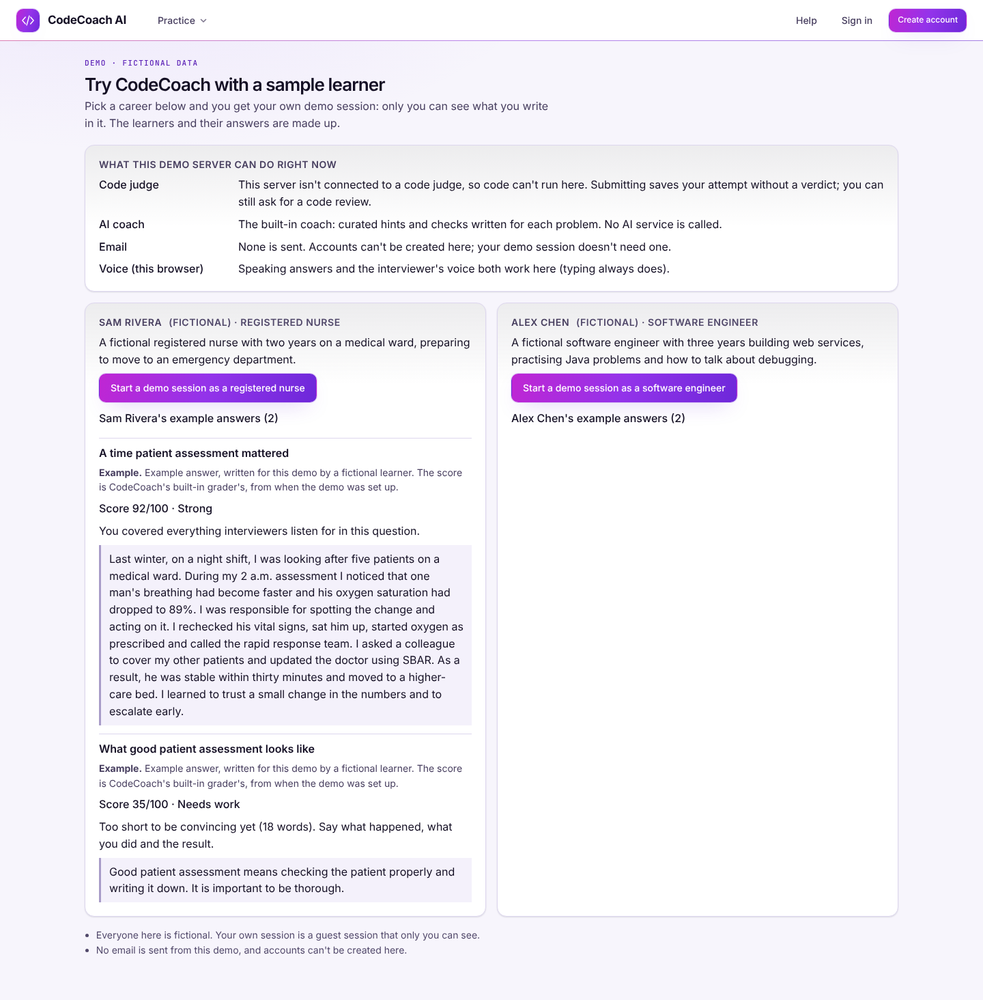

# The portfolio demo (Volume 7, prompt 10)

One repeatable demonstration. It shows the career-aware experience, an interview that survives a
reload, progress, and honest capability states, on a disposable database with fictional data. It
covers a small part of the product on purpose: about ten minutes, not every feature.

## The walkthrough (about ten minutes)

Open the demo server's start page. A banner says it's a demo with fictional data; **Try it now**
(or **Guided demo** in the header) opens `/demo`:



- **What this demo server can do right now** comes from the server's own capabilities: whether
  code runs (no judge here), which coach answers (the built-in one, so no AI service is called),
  that no email is sent, and what this browser offers for voice.
- **Two fictional sample learners.** Sam Rivera is a registered nurse; Alex Chen is a software
  engineer. Each has two example answers: one strong and one thin. Every example says it was
  written for the demo, and that its score came from the built-in grader when the demo was set up.
- **Start a demo session as a …** gives the visitor their own guest session for that career and
  opens a question. Each step links back with **Back to the demo**.

Things to try (listed on the page once a session has started):

1. **Answer a question.** You get written feedback on what the answer covered and what it missed.
2. *(Software engineer)* **Open a coding problem** and ask for a hint. Without a judge, Submit
   says "Saved, but not run yet". It never shows a verdict it didn't get.
3. **Run a short mock interview**, typed or spoken.
4. **Leave and come back.** Answer one question, then reload or open the interview in another tab.
   It carries on where you were, and the unsent draft is still there.
5. **See your progress** on the dashboard, built from what you just did.

## Running it locally

From `backend/`, with the dependencies installed:

1. Create and reset a demo database (a new SQLite file here):

   ```bash
   DATABASE_URL=sqlite:///./codecoach-demo.db python -m app.cli demo-reset --confirm codecoach-demo.db
   ```

2. Start the API in demo mode (the settings are in `deploy/demo.env.example`; set a fresh SECRET_KEY):

   ```bash
   DATABASE_URL=sqlite:///./codecoach-demo.db DEMO_MODE=true AI_PROVIDER=offline EMAIL_BACKEND=file SECRET_KEY=<your own key> uvicorn app.main:app
   ```

3. Start the frontend (`npm run dev` in `frontend/`) and open `http://localhost:5173/demo`.

`demo-reset` prints the target (passwords hidden) and the starting-state fingerprint. Run it twice
and the fingerprint is the same. The same database, reset again after visitors have used it, comes
back to that fingerprint too.

### What the reset refuses, before it changes anything

- A database whose name doesn't contain `demo`.
- A missing or different `--confirm NAME`. The name it wants is printed.
- A production server (`ENVIRONMENT=production`) without `DEMO_MODE=true`.
- Any account with an email address. A demo database never has one, because demo mode creates no
  accounts.
- Accounts but no sample learner: someone else's database, even one renamed to look like a demo.
- No tables, unless AUTO_MIGRATE is on. A new SQLite file is created the way the API's start-up
  creates it; PostgreSQL needs `alembic upgrade head` first.

It then empties every table except the problem catalogue and seeds the catalogue. It adds the
sample learners and their answers with fixed ids and times, then checks the result. A connection
that row-level security filters (the app role) leaves rows behind; the check catches that and
says to use the owner.

## What's isolated, and what's real

- **Visitors.** Each visitor is their own guest account, with the app's usual owner checks (and
  row-level security on PostgreSQL). A second visitor sees none of the first one's answers,
  interviews or history; tested in the API and in the browser. Guest sessions are deleted after
  GUEST_RETENTION_DAYS without use (1 in the demo configuration).
- **The sample.** The sample learners can't sign in (no email or password). Their answers are read
  through one read-only endpoint, `GET /api/v1/demo`, which answers only in demo mode and reads
  only their rows.
- **No email.** Demo mode refuses registration, guest upgrade, password reset, email change and
  verification emails (403 `demo_mode`). The email helper refuses again as a backstop. The browser
  run checks the server's outbox folder stays empty.
- **Real behaviour, not a recording.** Every answer a visitor writes is graded by the same grader as
  in the product. Interviews, resume and progress are the product's own. The only prepared content
  is the four labelled example answers.
- **Costs and abuse.** These are the product's existing limits: guest sessions 10 per minute per
  address, AI requests 50 per visitor per day, submissions 6 per minute and 2 pending per visitor.
  The demo configuration uses the built-in coach and no judge, so no paid service is called.

## Evidence

- **Backend: `backend/tests/test_demo.py`** (10 tests, SQLite and PostgreSQL with row-level
  security).
  - The target is shown without its password and must be confirmed.
  - A real-looking database is refused unchanged, even when named like a demo.
  - Guests without sample learners are refused, and so is a production server without demo mode.
  - Two resets give the same fingerprint, and visitors' work and counters are cleared.
  - The fingerprint changes when the sample does.
  - Not a demo server gives 404; demo not set up gives 503.
  - The sample is labelled and can't sign in.
  - No email can be sent (five routes refused, no email jobs).
  - Two visitors can't see each other's work.
- **Frontend: `frontend/src/test/integration/demo.test.tsx`** (5).
  - Capability states, both the unavailable ones and a live judge and AI.
  - Labelled examples.
  - Starting a session with a way back.
  - Not a demo server.
  - Register and header in demo mode.
- **Browser: `frontend/e2e-demo/demo.spec.ts`**, run with
  `npm run e2e -- --config playwright.demo.config.ts`, on desktop and a phone (6 runs).
  - Its server starts only after a fresh database has been reset twice to the same fingerprint.
  - It follows the guided path: a question, an interview that resumes after a reload, progress,
    with axe on the entry page.
  - A second visitor sees none of the first one's work and can't create an account.
  - A coding visitor's submission is said not to have run, and the built-in coach answers.
  - No email was written.
- Screenshots from that run, desktop and phone, are in `docs/screenshots/demo/`. Their data is
  fictional, and the only accounts are the run's own guest sessions.

## Limits

- **A configuration, not a deployment.** Publishing a demo (a host, a domain, HTTPS, production
  settings) is a separate, authorized step.
- **No judge or AI provider here.** The demo shows the unavailable states those produce. With a
  Linux sandbox or an AI key, the same pages show the real ones.
- **No CAPTCHA, and no global cap on guest sessions.** A public demo relies on the per-address
  limit and the daily guest clean-up.
- **The sample learners are two careers out of 110.** A visitor can still pick any career from the
  ordinary guest start.
